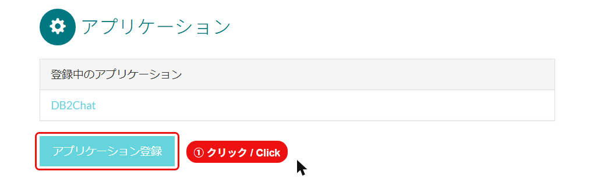
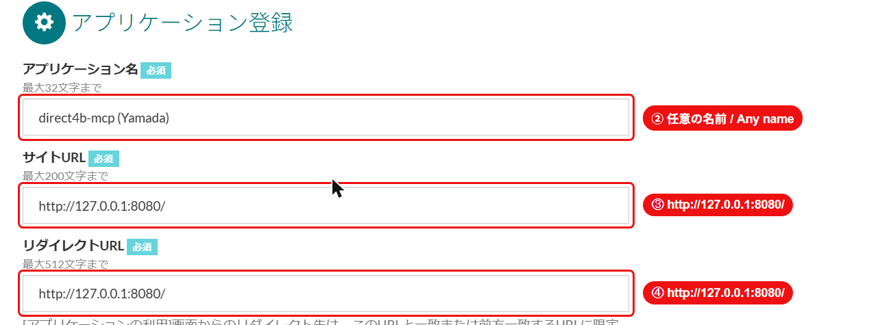
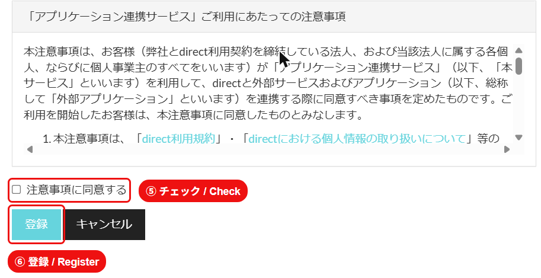
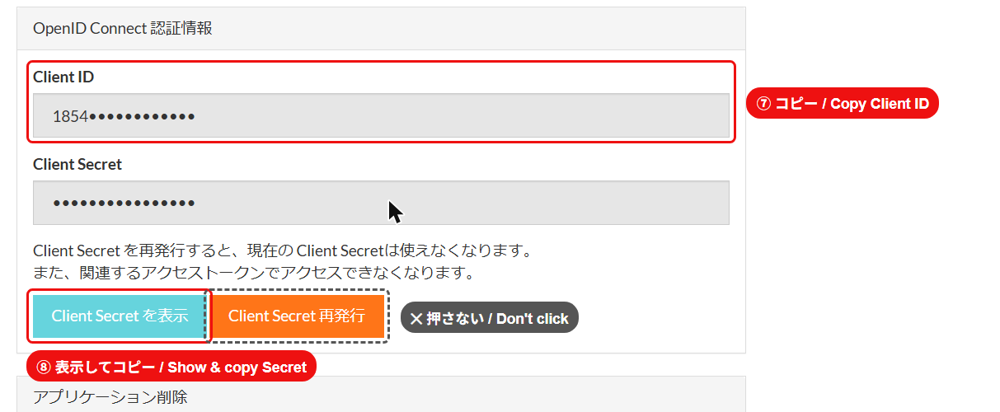

# セットアップガイド / Setup guide

所要時間：約5分（初回のみ） / About 5 minutes, one time only.
必要なもの：Node.js、direct にログインできるブラウザ / You need Node.js and a browser logged in to direct.

## 1. ログインコマンドを実行 / Run the login command

ターミナルで実行します。 / In a terminal:

```
npx direct4b-mcp login
```

ブラウザで direct の「アプリケーション」画面が自動で開きます。ターミナルはそのまま開いておいてください。
direct's "Applications" page opens in your browser. Keep the terminal open.

## 2. 自分用のアプリを登録 / Register your own app

**①「アプリケーション登録」をクリック / Click 「アプリケーション登録」**



**②〜④ 入力 / Fill in**

| 項目 / Field | 入力値 / Value |
|---|---|
| アプリケーション名 / Application name | 任意（例：`direct4b-mcp (山田)`） / anything |
| サイトURL / Site URL | `http://127.0.0.1:8080/` |
| リダイレクトURL / Redirect URL | `http://127.0.0.1:8080/` |

URL は最後の `/` まで完全に同じにしてください。 / The URLs must match exactly, including the trailing `/`.



**⑤ 注意事項に同意 → ⑥「登録」 / Agree, then click 「登録」 (Register)**



## 3. Client ID と Client Secret をターミナルに貼り付け / Paste Client ID and Secret into the terminal

登録後の画面で： / On the page shown after registering:

- **⑦ Client ID** をコピーして、ターミナルの `Client ID:` に貼り付け → Enter
- **⑧「Client Secret を表示」** を押して Secret をコピーし、`Client Secret:` に貼り付け → Enter
- 隣の **「Client Secret 再発行」は押さないでください**（今の Secret が使えなくなります）

- Copy **⑦ Client ID**, paste at the terminal's `Client ID:` prompt, press Enter.
- Click **⑧ 「Client Secret を表示」**, copy the Secret, paste at `Client Secret:`, press Enter.
- **Don't click 「Client Secret 再発行」** next to it; it invalidates the current secret.



2つの値は `~/.direct4b/client.env` に自動保存されます。次回からは入力不要です。
Both are saved to `~/.direct4b/client.env` automatically; you won't be asked again.

## 4. 承認 / Approve

ブラウザで承認画面が自動で開きます。**「承認する」** を押してください。
「direct4b login done」と表示されたら完了です。

The approval page opens automatically. Click **「承認する」 (Approve)**. When you see "direct4b login done", you're finished.

## 5. Claude Code / Cursor に登録 / Add to Claude Code or Cursor

**Claude Code:**
```
claude mcp add direct4b --scope user -- npx -y direct4b-mcp
```

**Cursor:** 設定 → MCP → Add new MCP server / Settings → MCP → Add new MCP server:
```json
"direct4b": { "command": "npx", "args": ["-y", "direct4b-mcp"] }
```

再起動すれば使えます。 / Restart the app and you're ready.

## 困ったとき / Troubleshooting

| 症状 / Symptom | 対処 / Fix |
|---|---|
| ブラウザが開かない / Browser doesn't open | 表示された URL を手動で開く / Open the printed URL yourself |
| `redirect_uri` のエラー / `redirect_uri` error | アプリのリダイレクトURLが `http://127.0.0.1:8080/` か確認 / Check the app's Redirect URL |
| ポート 8080 が使用中 / Port 8080 in use | 使っているアプリを閉じる / Close whatever uses it |
| ID/Secret を間違えた / Wrong ID or Secret | `~/.direct4b/client.env` を削除してやり直す / Delete it and run login again |

`~/.direct4b/` のファイルはあなたの direct アカウントの鍵です。他の人に渡さないでください。
The files in `~/.direct4b/` are keys to your direct account. Never share them.
